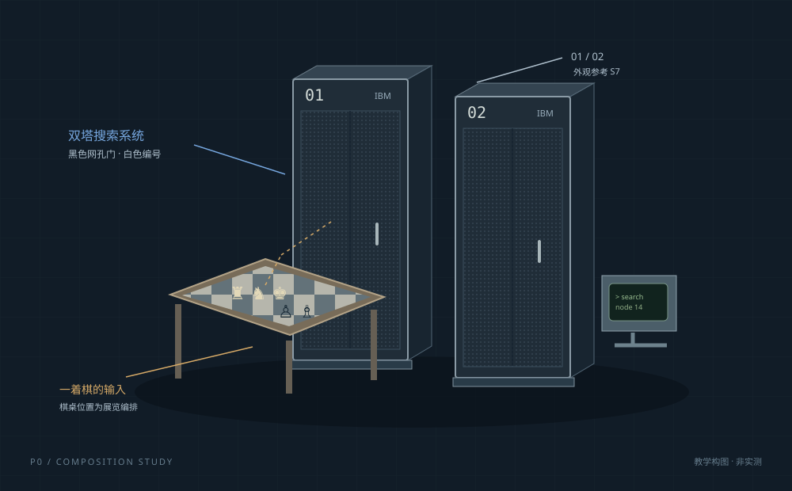
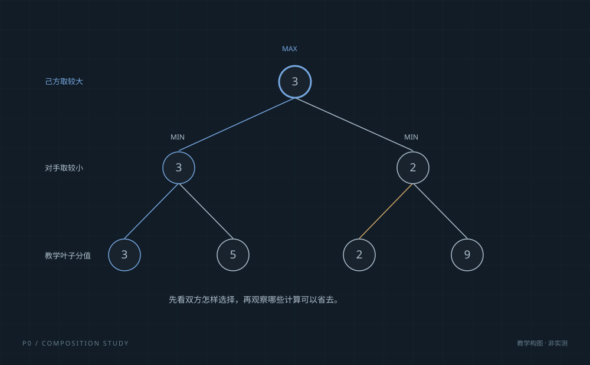
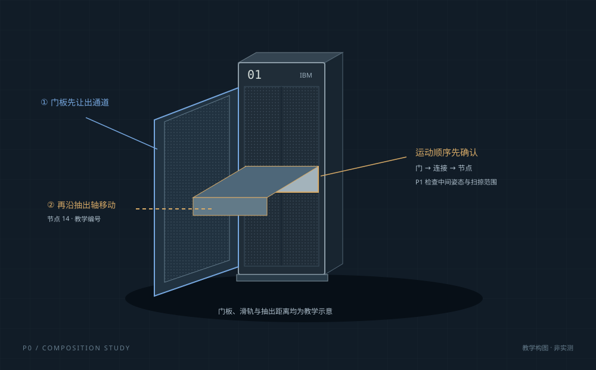
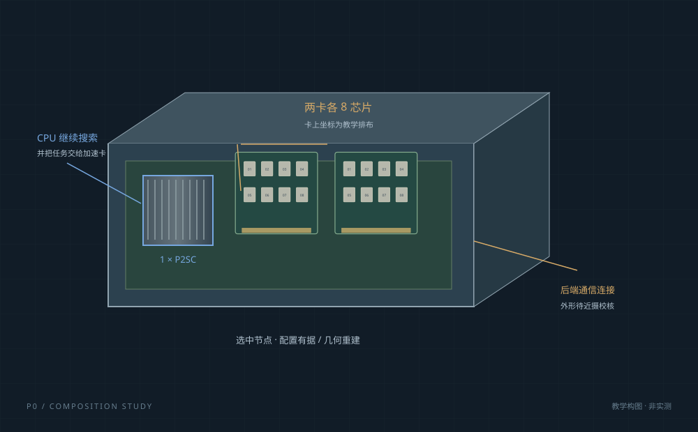
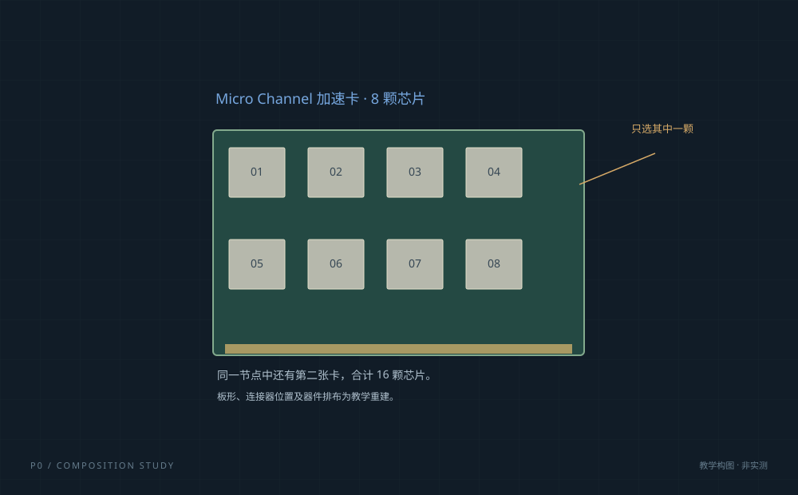
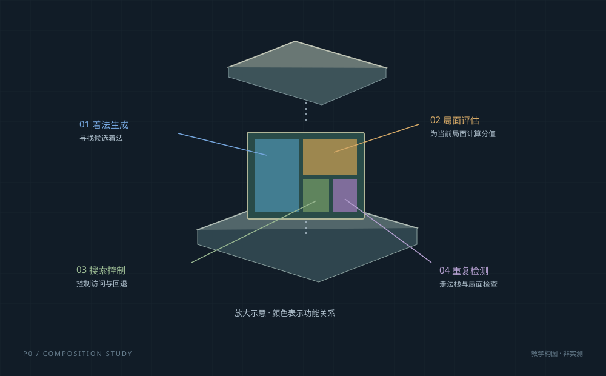

# P0 三层镜头分镜

静态图用于审阅构图与信息顺序；运动和相交检查安排在 P1。

## F01 · 先看见机器的体量

- 层级：宏观
- 镜头：三分之四正面；双柜为主，棋桌在前侧留出通道。
- 动作：机柜完整，棋桌局面待输入；点击开始进入教学。
- 问题：为什么算一着棋需要这么大的机器？
- P1 检查：首屏同时看见目的、主按钮和双柜；道具不挡柜门。
- 依据边界：外壳据 S7；棋桌与机柜并置为设计。

## F02 · 从棋局展开少量可能性

- 层级：宏观 → 原理
- 镜头：镜头保持整体；搜索树作为独立教学图层进入。
- 动作：先解释双方交替选择，再比较有无剪枝。
- 问题：它怎样考虑对手的回应？
- P1 检查：同一题目与排序；不把示意节点称为历史搜索日志。
- 依据边界：原理据 S1；树形与分值为教学设计。

## F03 · 先开门，再接近节点

- 层级：宏观 → 中观
- 镜头：向选中机柜缓慢推进；保留机柜边框作为位置参照。
- 动作：门板绕铰链让出通道，标记教学节点 14。
- 问题：集群里面，一个工作节点是什么？
- P1 检查：门完全让位后才拉节点；门板与棋桌扫掠范围不相交。
- 依据边界：外观据 S7；开门结构和编号位置为教学设计。

## F04 · 抽出节点，说明分工

- 层级：中观
- 镜头：跟随节点出柜，转到斜俯视；外盖独立移开。
- 动作：显示一个 CPU、两块各 8 芯片板卡；指示任务方向。
- 问题：通用处理器和专用芯片怎样合作？
- P1 检查：先断开连接；节点完整出柜后再移开外盖，避免穿插。
- 依据边界：数量与分工据 S1/S2；滑轨和主板布局为重建。

## F05 · 沿连接方向取出一张卡

- 层级：中观 → 微观
- 镜头：聚焦一张 8 芯片板卡；另一张留作参照后逐渐弱化。
- 动作：解除连接 → 沿插拔方向抬出 → 转到便于观察的角度。
- 问题：为什么需要专用象棋芯片？
- P1 检查：板卡离开连接器后才旋转；不得把两卡合成一张 16 芯片板。
- 依据边界：数量据 S2；PCB 排布为教学示意。

## F06 · 用功能剖面收束全程

- 层级：微观
- 镜头：单芯片特写，显示放大示意标签与返回整机入口。
- 动作：示意封装分离，裸片与四个功能标签依次出现。
- 问题：哪些计算被做进了电路？
- P1 检查：颜色不宣称真实版图；一键复原按原始姿态计算。
- 依据边界：裸片视觉据 S8；功能据 S1/S2；空间分区为设计。
